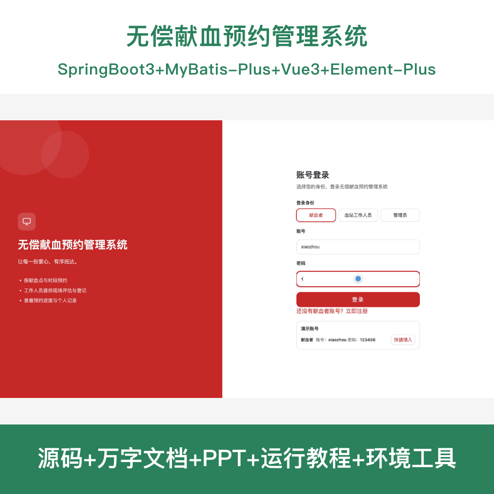
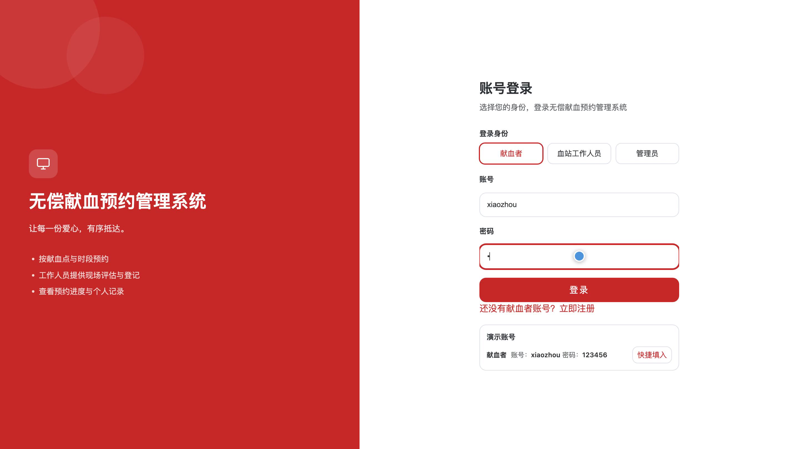
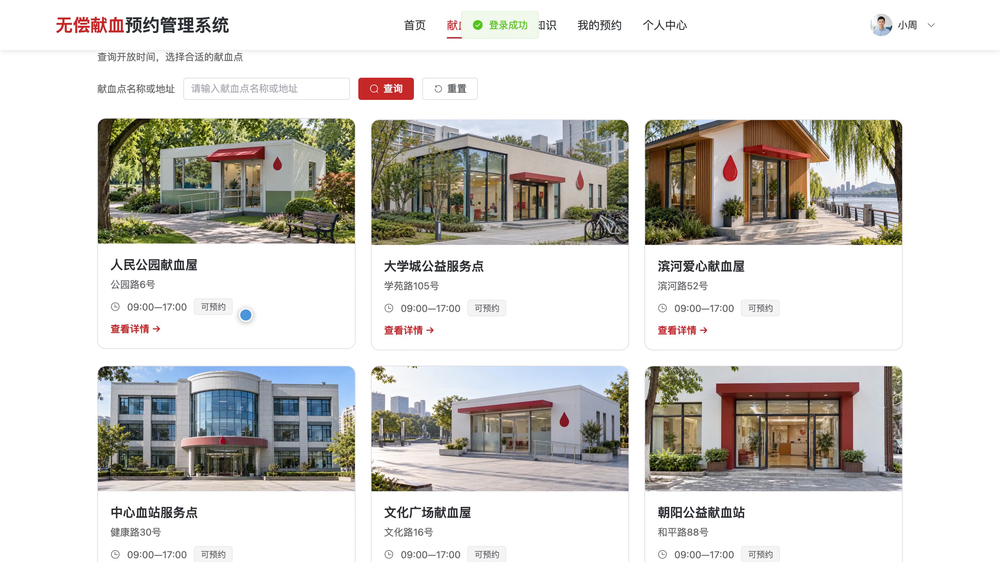
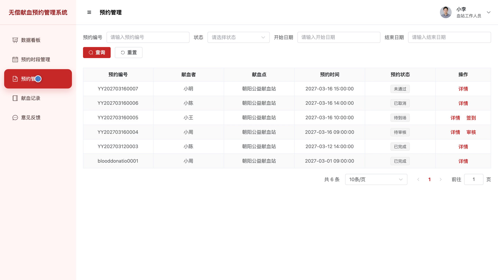
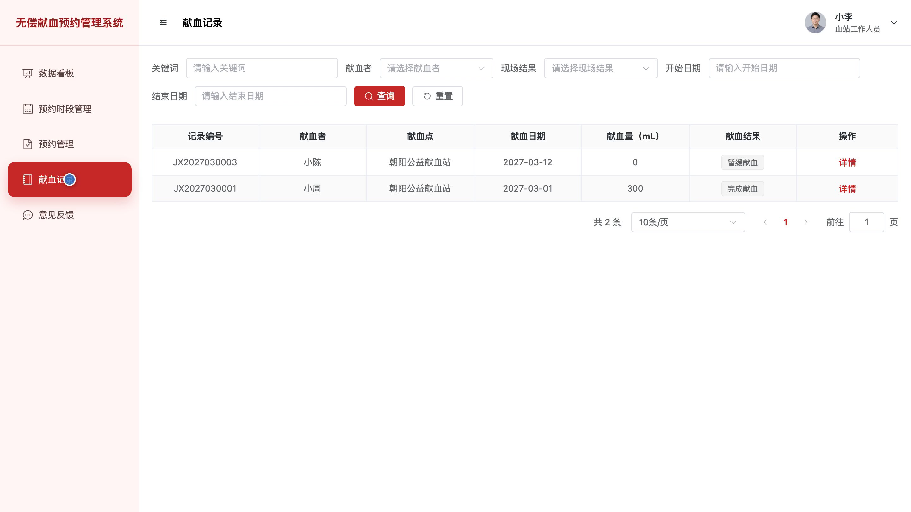
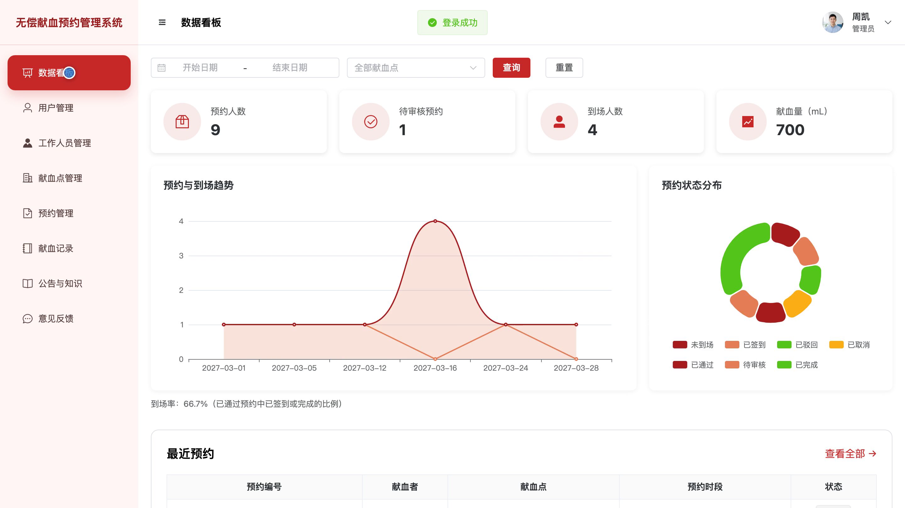
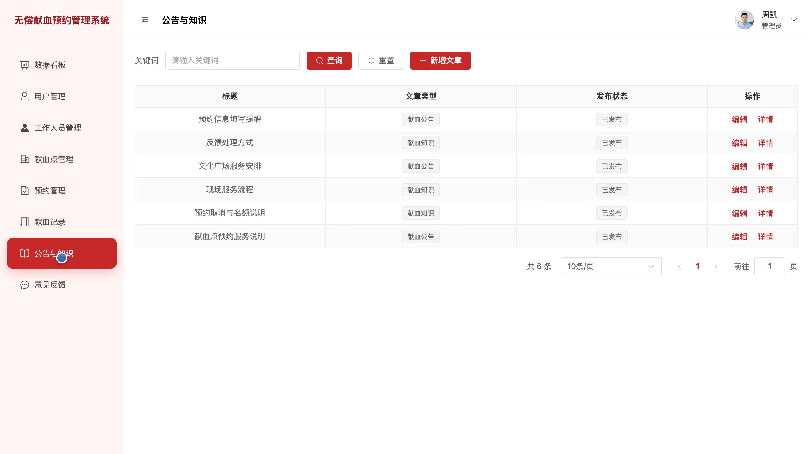

## 源码问题查看主页咨询

### 一、关键词
无偿献血预约、献血点查询、预约时段管理、献血记录、血站服务

### 二、作品包含
源码+数据库+全套环境和工具资源+本地部署教程

### 三、项目技术
前端技术： Html、Css、Js、Vue3.4、Element-Plus
后端技术：Java、SpringBoot3.2.0、MyBatis-Plus

### 四、运行环境要求
开发工具：IDEA/eclipse + VSCODE

数据库：MySQL5.7（共10张表）

数据库管理工具：Navicat10以上版本

环境配置软件： JDK17 + Maven3.6

前端Nodejs：>=20

浏览器：谷歌浏览器

### 五、项目介绍
项目编号：bs156A

无偿献血预约管理系统面向献血者、血站工作人员和管理员。献血者可查询献血点与开放时段、提交预约、查看献血记录并反馈意见；血站工作人员处理预约、维护预约时段并登记献血记录；管理员管理用户、工作人员、献血点、公告知识及业务信息。系统提供预约和记录服务，献血资格由现场评估确认。

角色：用户、血站工作人员、管理员

用户功能：献血点与开放时段查询、献血预约提交与结果查询、个人献血记录查询、公告与献血知识查看、意见反馈与个人资料管理。

血站工作人员功能：业务数据看板、预约时段管理、献血预约处理、献血记录登记与查询、意见反馈处理。

管理员功能：业务数据看板、用户与工作人员管理、献血点管理、献血预约与记录管理、公告知识与意见反馈管理。

### 六、运行截图

